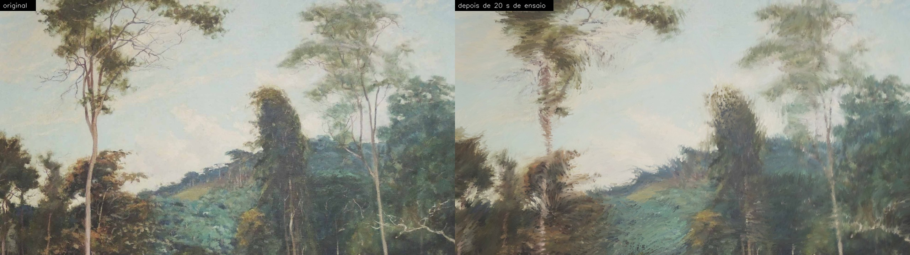
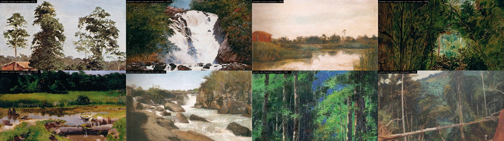
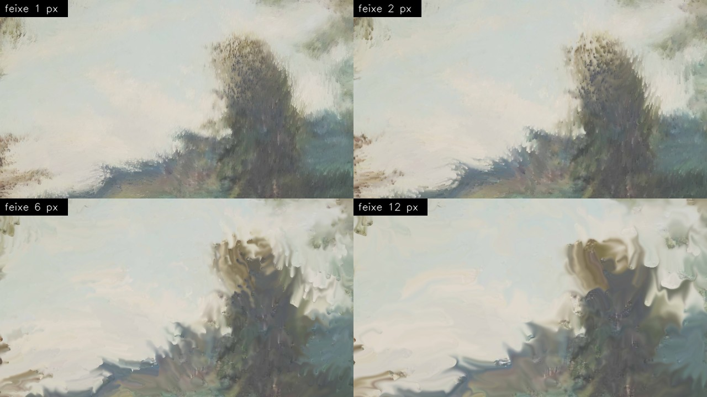
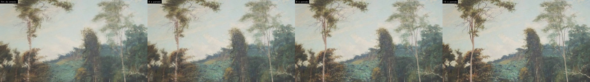
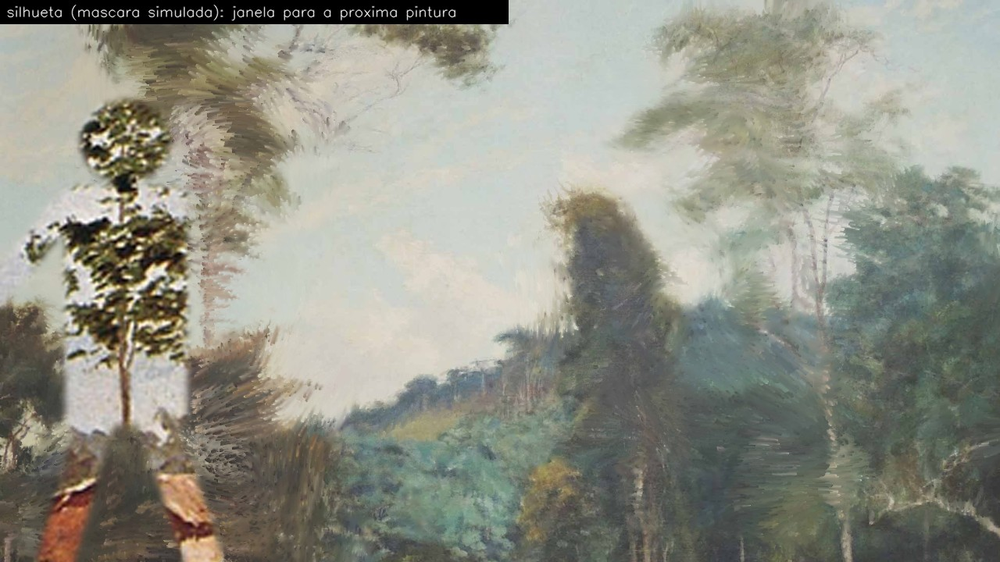
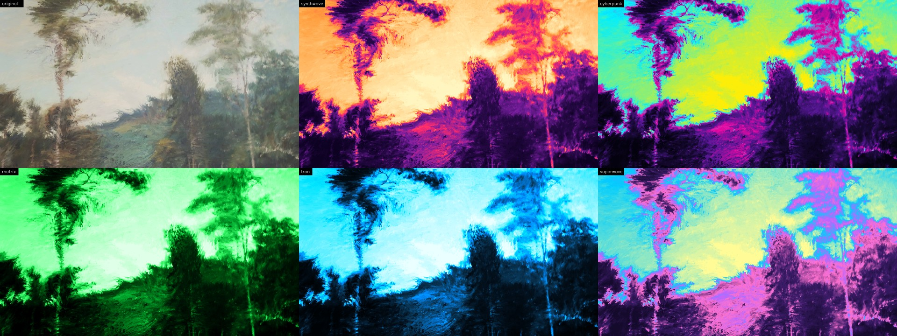

# Modo paisagens

O modo `paisagens` cobre a tela com uma pintura de paisagem, e o movimento dos dançarinos arrasta a tinta: os corpos borram e espalham as cores como se repintassem o quadro com pinceladas. Onde ninguém age por um tempo, a pintura original volta aos poucos.



*À esquerda, a pintura como cobre a tela; à direita, depois de 20 s de um vídeo de ensaio com sete pessoas. As árvores por onde os braços passaram viraram pinceladas arrastadas, mas a composição continua legível.*

## Como rodar

Depois de instalar (veja [Primeiros passos](../README.md#primeiros-passos) no README):

```bash
python dance_interactive_poc.py --mode paisagens                     # Kinect; sem Kinect, a webcam
python dance_interactive_poc.py --mode paisagens --source webcam
python dance_interactive_poc.py --mode paisagens --source ensaio.mp4
python dance_interactive_poc.py --mode paisagens --palette cyberpunk
python dance_interactive_poc.py --pi --mode paisagens                 # perfil do Raspberry Pi 4
```

O modo não depende do YOLO: funciona com a instalação leve (`requirements-pi.txt`). Sem argumentos além do modo, ele usa todas as pinturas da pasta [`paisagens/`](../paisagens/), começa pela primeira em ordem alfabética, com as cores originais, sem silhueta, força e espessura de feixe padrão e regeneração depois de 3 s parados. Duas janelas abrem: **Debug & Tracking** (câmera + desenho, com FPS, latência e os ajustes atuais) e **Projetor** (só a pintura). No `--pi` só a do projetor, em tela cheia.

### Teclas

As teclas valem com uma das janelas da PoC em foco; a PoC também as imprime no terminal ao abrir.

| Tecla | Ação |
| --- | --- |
| `a` / `z` | Pintura anterior / próxima da pasta (a nova começa limpa) |
| `p` | Próxima paleta de cores (original → synthwave → cyberpunk → matrix → tron → vaporwave) |
| `s` / `x` | Diminui / aumenta a força do borrão (passo 0,1, de 0 a 5; 0 congela a pintura) |
| `h` / `n` | Afina / engrossa os feixes do borrão (passo 1 px, de 1 a 16) |
| `d` / `c` | Diminui / aumenta a espera antes da regeneração (passo 1 s, de 0 a 60) |
| `f` / `v` | Diminui / aumenta o tempo de volta ao original (passo 5 s, de 2 a 300) |
| `g` | Liga / desliga a silhueta (janela para a próxima pintura) |
| `b` | Com Kinect, calibra o fundo da máscara de profundidade (com a sala vazia) |
| `t`, `-`, `=` | Metrônomo: liga / desliga, mais lento, mais rápido |
| `m` | Troca a fonte (Kinect, webcam, vídeo) e devolve a pintura original |
| `q` | Sai |

### Parâmetros

| Parâmetro | Padrão | O que faz |
| --- | --- | --- |
| `--image` | a pasta `paisagens/` | Uma imagem ou uma pasta de imagens (JPG, PNG, WebP, BMP), em ordem alfabética |
| `--image-anchor` | 0,5 | Nas imagens em paisagem: a faixa visível quando há corte (0 topo, 0,5 meio, 1 base) |
| `--gain` | 1 | Força do borrão: com 1, a tinta anda a 40% da velocidade do corpo |
| `--bristle-width` | 2 | Espessura dos feixes do borrão, em px do quadro processado |
| `--palette` | `original` | Cores: `original` ou uma paleta neon (veja [Paletas](#paletas-neon)) |
| `--regen-delay` | 3 | Segundos sem ação antes de a pintura começar a voltar |
| `--regen-time` | 20 | Segundos para a pintura voltar ao original depois da espera |
| `--silhouette` / `--no-silhouette` | desligada | Mostra a próxima pintura dentro dos corpos |
| `--pi` | — | Perfil do Raspberry Pi 4: só a janela do projetor, em tela cheia |

## Como funciona

A cada quadro da câmera:

1. **Movimento.** O quadro vai para cinza e é reduzido a 1/8; o Farneback calcula o fluxo óptico entre ele e o anterior. O fluxo é zerado onde a imagem não mudou: o Farneback inventa até ~3 px/quadro de movimento em áreas lisas ou estouradas mesmo entre quadros idênticos, o que borraria a pintura sem ninguém se mexer.
2. **Borrão.** A pintura é reamostrada ao longo do fluxo.
3. **Regeneração.** Onde não houve ação há algum tempo, a pintura original volta um pouco.
4. **Saída.** Por cima vêm a janela da silhueta e a paleta, e o resultado vai para o projetor.

Tudo está em [`dance_interactive_poc.py`](../dance_interactive_poc.py); os nomes abaixo são as classes e funções do arquivo, quase todas em [`LandscapeCanvas`](../dance_interactive_poc.py).

### Enquadramento

[`fit_cover`](../dance_interactive_poc.py) amplia a imagem até cobrir o quadro, sem distorcer, e corta o que sobra. Como a tela é horizontal e a maioria das pinturas é vertical, o corte costuma ser em cima e embaixo. Nas imagens em retrato, a altura do recorte é sorteada **toda vez que a imagem é carregada**: na partida, a cada `a`/`z` e para a pintura da janela da silhueta. Assim a mesma pintura volta com enquadramentos diferentes, e o overlay mostra o valor (`recorte 71%`, de 0% = topo a 100% = base). Nas imagens em paisagem vale `--image-anchor`.

Todas as imagens da pasta são lidas na partida: um arquivo ruim falha logo, e a troca pelo teclado não espera o disco.



*As oito pinturas da pasta como cobrem a tela, com o recorte no meio.*

### Borrão

[`LandscapeCanvas.update`](../dance_interactive_poc.py) faz uma advecção semi-Lagrangiana com `cv2.remap`: cada pixel busca a cor de onde o movimento veio. Onde nada se move, o mapa é a identidade e a pintura fica intacta, pixel a pixel; onde há movimento, a tinta é arrastada. As mudanças são permanentes: a pintura guarda o que os corpos fizeram até a regeneração ou um reset.

- **Força.** Com `--gain 1`, a tinta anda a 40% da velocidade do corpo (`LANDSCAPE_FLOW_SCALE`). A pleno, sete pessoas deixavam a pintura irreconhecível em ~5 s.
- **Cerdas.** Um ruído fixo e fino faz pixels vizinhos andarem quantidades diferentes (1 ± 0,8 desvio), e o rastro vira estrias ao longo do gesto, como pinceladas. Sem ele, o resultado era um marmorizado liso.
- **Espessura dos feixes.** `--bristle-width` (teclas `h`/`n`) controla o grão do ruído. Mudar a espessura refaz as cerdas (~15–25 ms naquele quadro) sem desfazer o borrão já feito, e o valor é em px do quadro processado: o mesmo número dá estrias mais grossas, na tela, em 640×480 do que em 1280×720.
- **Cálculo dos mapas.** Os mapas do `remap` são calculados com operações do OpenCV (`LANDSCAPE_SMEAR_BACKEND = "opencv"`), ~20% mais rápido que a versão original em NumPy, que continua no código. O arredondamento do OpenCV difere em até ~1e-4 px: num trecho de 400 quadros, 13 de 921 600 pixels terminaram 1 nível (de 255) diferentes.



*O mesmo trecho de ensaio com feixes de 1, 2 (o padrão), 6 e 12 px: estrias finas, pinceladas largas e manchas quase lisas.*

### Regeneração

[`LandscapeCanvas.regenerate`](../dance_interactive_poc.py) devolve a pintura original onde ninguém age:

- o tempo parado é contado por região, na grade do fluxo (1/8 do quadro); uma região com movimento, ou vizinha dele, zera o relógio;
- depois de `--regen-delay` segundos parada, a região passa a misturar um pouco da pintura original a cada passo (cross-fade), entrando em 1 s, sem degrau, e fica completa em ~`--regen-time` segundos; onde os dançarinos continuam agindo, ela não volta;
- a mistura roda a cada 8 quadros, com o passo acumulado, em 16 bits e com um só arredondamento. Em 8 bits um passo pequeno arredonda para zero e a pintura pararia a 10–16 níveis do original; o último resíduo é copiado do original, então ela volta exatamente ao que era.



*Fim do ensaio e depois 4, 8 e 16 s de cena parada. No teste, a tela ficou idêntica ao original em ~18 s.*

### Silhueta

Com `--silhouette` (tecla `g`), os corpos viram uma janela para a **próxima pintura da lista**, sem borrão; com uma imagem só, a janela mostra a própria pintura original, sem as pinceladas. É ao vivo: a tela borrada por baixo não muda, e quando o corpo sai a pintura atual reaparece como estava. A máscara vem da profundidade do Kinect (`b` calibra o fundo) ou, nas outras fontes, de um MOG2 em 1/4 da resolução; a borda é macia no perfil normal e dura no `--pi`.



*A figura mostra* As Lavadeiras *por dentro da pintura borrada. Para a imagem, a máscara é uma figura sintética como a do Kinect; no vídeo de ensaio, o MOG2 quase não separa os dançarinos (veja [Limitações](#limitações)).*

### Paletas neon

`--palette` (tecla `p`) troca as cores da pintura por uma paleta de estética cyberpunk. É um mapa de gradiente: o brilho de cada pixel vira uma cor da paleta, do escuro ao claro, e o brilho de cada pintura é esticado entre os percentis 2 e 98 para ocupar o gradiente todo (as pinturas são escuras). A paleta é aplicada só no desenho, não na pintura guardada: trocar é instantâneo e mantém o borrão, a regeneração e a janela da silhueta, que também fica neon. As paletas ficam em `LANDSCAPE_PALETTES` (cores de parada, do escuro ao claro), fáceis de editar.



*`original`, `synthwave`, `cyberpunk`, `matrix`, `tron` e `vaporwave`, sobre a mesma pintura borrada.*

Como tudo vem do brilho, os matizes originais se perdem: um verde claro e um vermelho claro viram a mesma cor da paleta.

## Desempenho

Medido num i7-4790 (2014). As medições em 640×480 usam [`pi_benchmark.py`](../pi_benchmark.py) `--mode paisagens`, quadros sintéticos de Kinect e OpenCV limitado a 1 thread; as de 1280×720 usam um vídeo de ensaio com sete pessoas e 8 threads.

| Resolução | Situação | ms/quadro (mediana) |
| --- | --- | ---: |
| 640×480, 1 thread | mapas em OpenCV (padrão) / em NumPy | 4,7 / 5,6 |
| 1280×720 | padrão (cores originais, sem silhueta) | 12,0 |
| 1280×720 | com a paleta `cyberpunk` | 12,4 |
| 1280×720 | com a silhueta (MOG2) | 18,5 |

O que pesa:

- **O borrão** é ~70–80% do quadro.
- **A regeneração** custa em média ~0,4 ms por quadro em 640×480 e ~1,1 ms em 720p. O quadro em que a mistura roda, um a cada 8, fica ~3 ms (640×480) ou ~9 ms (720p) mais lento.
- **A paleta** custa ~0,5 ms em 640×480 e ~1,4 ms em 720p.
- **A silhueta** custa ~6 ms em 720p, a maior parte no MOG2.
- **Trocar de pintura** custa ~15 ms naquele quadro.

Num núcleo do Raspberry Pi 4, 4–6× mais lento que este (estimativa, não medida), os 4,7 ms viram ~19–28 ms: cabem nos 30 fps do Kinect. O quadro da regeneração, porém, pode passar do limite quando também há borrão e perder um quadro a cada 8. Se isso aparecer, a mistura pode ser dividida entre quadros seguidos.

## Limitações

- **Silhueta com MOG2.** Com webcam ou vídeo, a silhueta só separa o que se move do fundo. Quem já estava em cena quando o MOG2 começou a aprender, ou fica parado por ~15 s, some dela; no vídeo de ensaio, a janela quase não aparece. Com o Kinect, a máscara vem da profundidade e não tem esse problema.
- **A câmera vê a projeção.** O fluxo óptico é calculado no RGB da câmera. Numa instalação, se a câmera vir a própria pintura projetada mudando, ela pode se borrar sozinha, e o borrão é permanente até a regeneração. A profundidade do Kinect é infravermelha e não vê a projeção; calcular o fluxo nela evitaria o problema, mas ainda não está implementado.
- **Resolução das pinturas.** Várias imagens da pasta são pequenas (*As Lavadeiras* tem 419 px de largura). Em 1280×720 elas são ampliadas 2–3× e ficam suaves; em 640×480 (Kinect) a perda é menor, e o borrão a disfarça em parte.
- **Recorte sorteado.** Nas pinturas em retrato o recorte sorteado pode deixar de fora a parte que dá nome ao quadro; não há, por enquanto, enquadramento fixo por pintura.
- **Projetor e Raspberry Pi ainda não testados.** Os números do Pi são estimativas, e a PoC ainda não rodou num projetor real.

## Acervo

As pinturas da pasta [`paisagens/`](../paisagens/), com autor, título e ano lidos dos nomes dos arquivos (os títulos podem não ser os oficiais das obras):

| Arquivo | Autor | Título | Ano |
| --- | --- | --- | --- |
| `almeida-junior-as-lavadeiras-1875.jpg` | Almeida Júnior | As Lavadeiras | 1875 |
| `almeida-junior-cascata-de-votorantim-1893.jpg` | Almeida Júnior | Cascata de Votorantim | 1893 |
| `almeida-junior-paisagem-1890.jpg` | Almeida Júnior | Paisagem | 1890 |
| `almeida-junior-paisagem-do-rio-das-pedra-1889.jpg` | Almeida Júnior | Paisagem do Rio das Pedras | 1889 |
| `almeida-junior-paisagem-fluvial-1899.jpg` | Almeida Júnior | Paisagem Fluvial | 1899 |
| `almeida-junior-salto-de-itu-sem-data.jpg` | Almeida Júnior | Salto de Itu | sem data |
| `aurelio-de-figueiredo-floresta-1892.jpg` | Aurélio de Figueiredo | Floresta | 1892 |
| `aurelio-de-figueiredo-paisagem-1898.jpg` | Aurélio de Figueiredo | Paisagem | 1898 |

São reproduções fotográficas; uma delas (`aurelio-de-figueiredo-paisagem-1898.jpg`) tem uma marca d'água "CDA" no centro. Para usar outras imagens, basta pôr os arquivos na pasta ou apontar `--image` para outra.

## Regerar as imagens

As imagens desta página são geradas por [`gerar_imagens_paisagens.py`](gerar_imagens_paisagens.py), com uma semente fixa. Só a saída da PoC é salva, nunca os quadros da câmera:

```bash
python docs/gerar_imagens_paisagens.py                              # só o acervo
python docs/gerar_imagens_paisagens.py --video videos/MVI_1732.MOV   # + borrão, feixes, paletas, regeneração e silhueta
```
