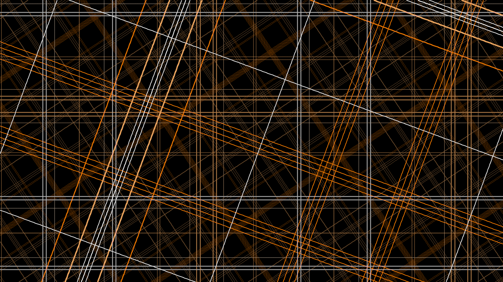
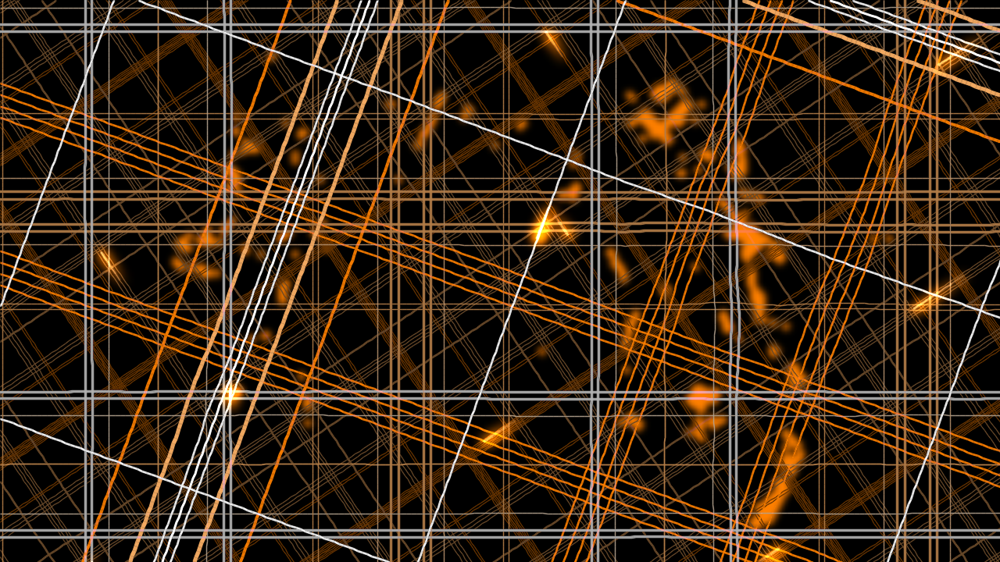
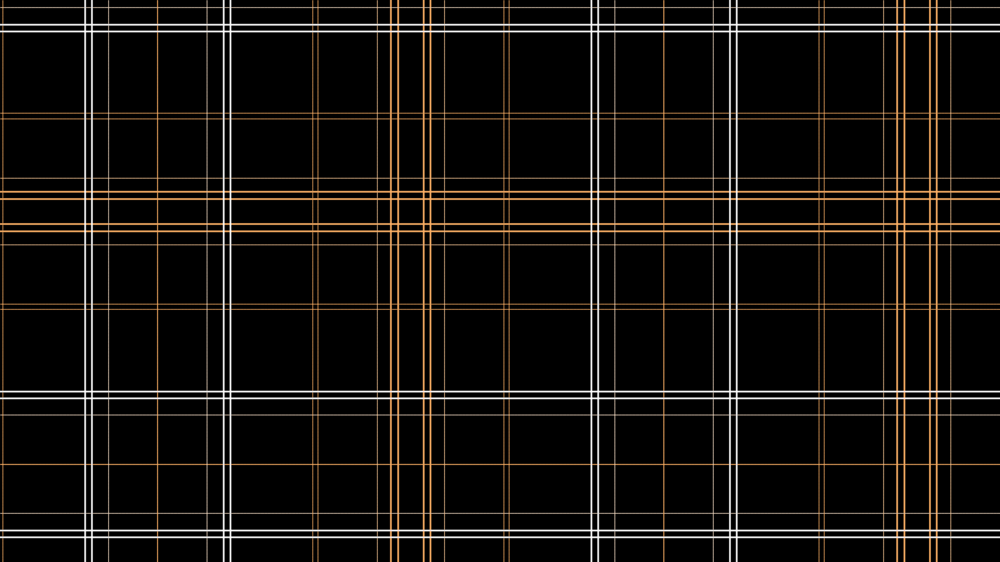
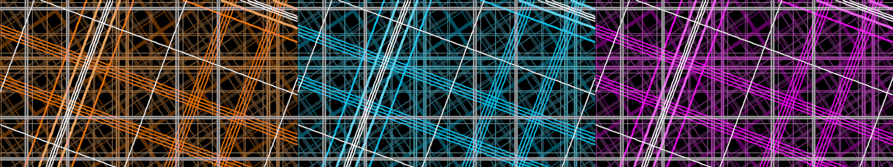

# Modo xadrez

O modo `xadrez` projeta um xadrez Madras — faixas de linhas finas que se cruzam formando quadros de tamanhos desiguais, como nas camisas de algodão indianas — que os corpos dos dançarinos empurram, deformam e iluminam. É o modo padrão da PoC.



*O padrão em repouso, no layout `mix` (o padrão): três malhas independentes, em ângulos e densidades diferentes. A distante é densa e escura, a do meio é a malha regular e a próxima tem quadros grandes e linhas mais grossas.*



*O mesmo padrão depois de 10 s de um vídeo de ensaio com sete pessoas. As linhas se curvam onde houve movimento, os pulsos de neon percorrem as linhas e as manchas laranja são a silhueta dos corpos. Com webcam ou vídeo a silhueta vem do MOG2 e sai parcial (veja [Limitações](#limitações)); com o Kinect ela vem da profundidade e cobre o corpo inteiro.*

## Como rodar

Depois de instalar (veja [Primeiros passos](../README.md#primeiros-passos) no README):

```bash
python dance_interactive_poc.py                     # Kinect; sem Kinect, cai para a webcam
python dance_interactive_poc.py --source webcam
python dance_interactive_poc.py --source ensaio.mp4
python dance_interactive_poc.py --pi                # perfil do Raspberry Pi 4
```

Sem argumentos, a PoC abre o xadrez com o layout `mix`, matiz laranja (30°), silhueta ligada, pulsos nascendo das mãos e densidade e ganho 1. Duas janelas abrem: **Debug & Tracking** (câmera + desenho, com FPS, latência e os ajustes atuais) e **Projetor** (só o desenho, em fundo preto). No `--pi` só a do projetor, em tela cheia.

### Teclas

As teclas valem com uma das janelas da PoC em foco; a PoC também as imprime no terminal ao abrir.

| Tecla | Ação |
| --- | --- |
| `a` / `z` | Diminui / aumenta a densidade (×1,1 por toque; de 0,25 a 4, até 2 no `mix`) |
| `s` / `x` | Diminui / aumenta o ganho, quanto o movimento empurra as linhas (passo 0,1, de 0 a 5) |
| `h` / `n` | Diminui / aumenta a sensibilidade, quanto movimento basta para interagir (×1,25 por toque, de 0,25 a 4) |
| `d` / `c` | Gira o padrão −5° / +5° |
| `f` / `v` | Gira o matiz no disco de cores −10° / +10° |
| `g` | Liga / desliga a silhueta dos corpos |
| `l` | Alterna o layout entre `mix` e `regular` |
| `b` | Com Kinect, calibra o fundo da máscara de profundidade (com a sala vazia) |
| `t`, `-`, `=` | Metrônomo: liga / desliga, mais lento, mais rápido |
| `m` | Troca a fonte (Kinect, webcam, vídeo) |
| `q` | Sai |

### Parâmetros

| Parâmetro | Padrão | O que faz |
| --- | --- | --- |
| `--density` | 1 | Densidade do padrão: maior dá mais linhas e quadros menores |
| `--gain` | 1 | Quanto o movimento empurra as linhas (a força) |
| `--sensitivity` | 1 | Quanto movimento basta para interagir com as linhas (veja [Sensibilidade](#sensibilidade)) |
| `--rotation` | 0 | Rotação do padrão, em graus, em torno do centro |
| `--hue` | 30 | Matiz base, em graus (0 vermelho, 30 laranja, 120 verde, 240 azul) |
| `--layout` | `mix` | `mix` (três malhas em alturas diferentes) ou `regular` (uma) |
| `--pulse-source` | `hands` | De onde nascem os pulsos: `hands` (onde as mãos tocam as linhas) ou `random` (sorteados) |
| `--pulses` | 4 | Com `--pulse-source random`: pulsos que nascem por segundo, em média; 0 desliga |
| `--silhouette` / `--no-silhouette` | ligada | Preenche a silhueta dos corpos com a cor base |
| `--pi` | — | Perfil do Raspberry Pi 4 (veja [Desempenho](#desempenho)) |

## Como funciona

A cada quadro da câmera:

1. **Movimento.** O quadro vai para cinza e é reduzido a 1/8 (80×60 a partir de 640×480); o Farneback calcula o fluxo óptico entre ele e o anterior. O fluxo é zerado onde a imagem não mudou: o Farneback inventa até ~3 px/quadro de movimento em áreas lisas ou estouradas mesmo entre quadros idênticos.
2. **Física.** Cada linha é uma cadeia de nós; o fluxo sob cada nó o empurra, e molas o devolvem ao lugar.
3. **Desenho.** As linhas viram curvas suaves, os pulsos andam sobre elas e a silhueta é desenhada por baixo.
4. **Saída.** O resultado vai para a janela do projetor; a de debug mostra também a câmera.

Tudo está em [`dance_interactive_poc.py`](../dance_interactive_poc.py); os nomes abaixo são as classes e funções do arquivo.

### O padrão Madras

[`make_madras_sett`](../dance_interactive_poc.py) sorteia, uma vez na partida, um *sett* — a sequência de faixas que define um tecido xadrez:

- cada faixa tem de 1 a 6 linhas paralelas do mesmo tom e espessura (1 a 3 px), com 0,6% a 1,3% da altura do quadro entre elas;
- entre as faixas, vãos que alternam ao acaso entre pequenos (1,2% a 3,5% da altura) e grandes (6% a 16%) — é isso que deixa os quadros desiguais;
- o sett é espelhado, como nos tecidos Madras, e repetido; o mesmo sett vale para as linhas horizontais e verticais, cada direção com sua fase.

O sett é guardado em frações da altura do quadro. Mudar densidade, rotação ou layout redesenha o mesmo tecido, ampliado ou girado, e não um tecido novo.

### Linhas elásticas

[`PlaidField`](../dance_interactive_poc.py) monta as linhas de uma malha e [`ElasticLines`](../dance_interactive_poc.py) cuida da física e das curvas:

- **Nós.** Cada linha tem um nó a cada 40 px; as pontas ficam 40 px fora do quadro e não se movem.
- **Molas.** A cada quadro, cada nó interno recebe o fluxo óptico amostrado sob ele (× 0,3 × ganho; movimentos abaixo do mínimo da [sensibilidade](#sensibilidade) não contam), uma mola que o puxa de volta ao repouso (rigidez 0,04), uma tensão que o puxa para a média dos vizinhos (0,15, como uma corda esticada) e amortecimento (0,85). O deslocamento fica limitado a 90 px.
- **Curvas.** Os nós viram uma curva Catmull-Rom, uma sequência de Bézier cúbicas que passa por todos eles, com 6 amostras por trecho.
- **Linhas grossas.** No OpenCV, uma linha anti-aliased grossa custa ~3× uma fina. As de 2 px ou mais são desenhadas finas numa camada separada, engrossadas com `dilate` e compostas com `max` — ~2,8× mais rápido, com aparência quase igual.

### Sensibilidade

Ganho e sensibilidade são coisas diferentes:

- o **ganho** (`--gain`, `s`/`x`) diz *com que força* o movimento empurra as linhas;
- a **sensibilidade** (`--sensitivity`, `h`/`n`, padrão 1, de 0,25 a 4) diz *quanto movimento basta* para os corpos interagirem com elas.

Ela age nas duas formas de interação:

| Interação | Com sensibilidade 1 | O que a sensibilidade muda |
| --- | --- | --- |
| Fluxo óptico empurrando as linhas | movimento acima de 0,15 px/quadro na imagem reduzida a 1/8 (~1,2 px/quadro no quadro original) conta | o mínimo é dividido por ela: com 2, movimentos duas vezes mais lentos já empurram |
| Mão disparando pulsos: movimento | a mão precisa andar 2% da altura do quadro entre detecções | o mínimo é dividido por ela |
| Mão disparando pulsos: alcance | a mão dispara linhas a até 2,5% da altura do quadro | o alcance é multiplicado por ela |

O filtro do movimento fantasma do Farneback (o fluxo é zerado onde a imagem não mudou) não depende da sensibilidade, então aumentá-la não traz de volta o falso movimento em áreas paradas. Os limites anti-inundação dos pulsos (por mão, por linha e 12 linhas por segundo no total) também não mudam.

O que se vê na prática:

- **Nas linhas:** no vídeo de ensaio, o deslocamento médio foi de 0,60 px (sensibilidade 0,5) a 0,78 (1), 0,90 (2) e 0,97 px (4). O efeito é moderado porque, num ensaio, quase todo movimento já passa do mínimo; a diferença aparece nos movimentos lentos e sutis.
- **Nos pulsos, com muita gente:** com sete pessoas mexendo os braços, o limite de 12 linhas por segundo fica sempre cheio e manda mais que a sensibilidade (~94 linhas em 7 s em qualquer valor).
- **Nos pulsos, com pouca gente:** aí ela decide quais gestos contam. Numa mão isolada, um gesto de 1,2% da altura por detecção dispara com sensibilidade 2, mas não com 1; um de 3% dispara com 1, mas não com 0,5.
- **O alcance pesa pouco no `mix`:** o padrão é tão denso que quase todo gesto passa perto de alguma linha mesmo com o menor alcance, então ali a sensibilidade age mais pelo movimento mínimo do que pela distância.

Valores acima de ~2,5 baixam o movimento mínimo da mão para menos de 0,8% da altura, perto do tremor do YOLO: mãos paradas podem começar a disparar.

### Layouts `mix` e `regular`

[`PlaidStack`](../dance_interactive_poc.py) empilha as malhas conforme `PLAID_LAYOUTS`:

| Camada | Densidade | Brilho | Espessura | Empurrão do fluxo |
| --- | --- | --- | --- | --- |
| Distante | 2× | 40% | −1 px | 0,5× |
| Meio (a malha `regular`) | 1× | 70% | igual | 1× |
| Próxima | 0,55× | 100% | +1 px | 1,6× |

No `mix`, cada camada tem seu próprio sett e um desvio de ângulo sorteado na partida, a pelo menos 20° das outras (medido módulo 90°, porque o xadrez se repete a cada 90°). Com o mesmo ângulo, as linhas ficariam paralelas e o `mix` só pareceria mais denso. O empurrão diferente por camada é uma paralaxe: o que está perto se move mais. A camada do meio é exatamente a malha `regular`, então a tecla `l` só acrescenta ou tira as outras duas. No `mix`, a densidade fica limitada a 2: acima disso a camada distante vira textura e o custo dispara.



*O layout `regular`, com o mesmo sorteio: só a malha do meio.*

### Cores

Todas as linhas partem de um único matiz base (`--hue`, teclas `f`/`v`). Cada faixa sorteia um de 6 níveis de mistura com branco, da cor pura ao branco ([`plaid_palette`](../dance_interactive_poc.py)). Trocar o matiz não refaz as linhas: as cores são calculadas na hora de desenhar.



*O mesmo sorteio em 30° (laranja, o padrão), 190° e 300°.*

### Pulsos de neon

[`NeonPulses`](../dance_interactive_poc.py) faz pontos de luz percorrerem as linhas, como informação. Por padrão eles **nascem das mãos**:

- [`HandTracker`](../dance_interactive_poc.py) roda o YOLOv8-pose (o mesmo do modo `conexoes`) numa thread própria, sempre no quadro mais novo; o xadrez usa a última detecção pronta sem esperar, então a inferência (~15–20 ms em CPU) não entra no tempo de cada quadro;
- a mão é um ponto um pouco além do punho, na direção cotovelo → punho (35% do antebraço);
- quando a mão, em movimento, passa a até 2,5% da altura do quadro de uma linha (com sensibilidade 1), nascem dois pulsos no ponto de contato, um para cada lado, e a cauda cresce a partir dali;
- para só gestos dispararem: a mão precisa andar ao menos 2% da altura entre detecções (com sensibilidade 1) (o punho do YOLO treme ~0,5–1% mesmo parado); cada mão dispara uma linha por vez e espera 0,25 s; cada linha espera 1 s; e no total disparam no máximo 12 linhas por segundo. Sem esses limites, sete pessoas mexendo os braços faziam nascer ~240 pulsos por segundo;
- na janela de debug, as mãos detectadas aparecem como círculos amarelos (nunca na projeção);
- sem o YOLO instalado (a instalação leve, `requirements-pi.txt`, não tem), a PoC avisa e os pulsos voltam a nascer sorteados.

Com `--pulse-source random`, os pulsos são sorteados:

- nascem em intervalos aleatórios (processo de Poisson, `--pulses` por segundo em média), numa linha e ponta sorteadas;
- cada um leva de 1 a 6 s, sorteado, para atravessar a linha, em tempo real: a velocidade não depende do FPS;
- a posição é medida ao longo da curva, então o pulso acompanha a linha deformada;
- a cauda apaga para trás, com núcleo claro (o matiz misturado a branco) e um halo do matiz puro, desenhado a 1/4 da resolução, borrado e somado ao quadro. Núcleo e halo só são somados, então nunca escurecem a linha por baixo;
- no máximo 150 ao mesmo tempo (40 no `--pi`).

### Silhueta

A silhueta preenche os corpos com a cor pura do matiz, por baixo das linhas e dos pulsos. A máscara vem da profundidade do Kinect (faixa `--min-depth`/`--max-depth`; `b` calibra o fundo) ou, nas outras fontes, de um MOG2 em 1/4 da resolução. Ela é limpa, suavizada e colorida em 1/4 e só então ampliada: o resultado é o mesmo de colorir em resolução cheia, por uma fração do custo.

## Desempenho

Medido num i7-4790 (2014). As medições em 640×480 usam [`pi_benchmark.py`](../pi_benchmark.py), quadros sintéticos de Kinect e OpenCV limitado a 1 thread; as de 1280×720 usam um vídeo de ensaio com sete pessoas e 8 threads. Os números são de processamento por quadro; a exibição e a captura rodam em outras threads.

| Resolução | Perfil | Layout | Silhueta | Linhas | ms/quadro |
| --- | --- | --- | --- | ---: | ---: |
| 640×480 | normal | regular | não / sim | 83 | 6,0 / 6,9 |
| 640×480 | normal | mix | não / sim | 301 | 13,4 / 14,2 |
| 640×480 | `--pi` | regular | não / sim | 83 | 4,5 / 5,6 |
| 640×480 | `--pi` | mix | não / sim | 301 | 12,0 / 12,7 |
| 1280×720 | normal | regular | não / sim | 56 | 12,4 / 16,5 |
| 1280×720 | normal | mix | não / sim | 296 | 24,4 / 29,0 |

Com os pulsos das mãos, o YOLO roda em paralelo: no vídeo de ensaio, a 30 fps reais, o quadro do xadrez passou de ~34 para ~37 ms (GPU) ou ~40 ms (OpenVINO em CPU), e a detecção dos toques custa ~2,5–3 ms (picos de até 16 ms). A inferência ocupa outro núcleo da CPU (ou a GPU).

O número de linhas depende do sett sorteado e da rotação. O custo cresce com elas: o padrão (`mix` com silhueta) é a configuração mais pesada, e em 720p fica perto do limite de 30 fps neste PC. Se faltar FPS, nesta ordem:

1. **Diminua a densidade** (`a`), porque a camada distante concentra mais da metade das linhas.
2. **Use o layout `regular`** (`l`).
3. **Use uma câmera em 640×480.**

O perfil `--pi` tira o anti-aliasing, usa 3 amostras por trecho de curva, limita os pulsos a 40, deixa a borda da silhueta dura e abre só a janela do projetor. Num núcleo do Raspberry Pi 4, 4–6× mais lento que este (estimativa, não medida), isso daria ~22–34 ms por quadro no `regular` e ~50–75 ms no `mix`. Rode `python pi_benchmark.py` no Pi para trocar a estimativa por números.

## Limitações

- **Silhueta com MOG2.** Com webcam ou vídeo, a silhueta só separa o que se move do fundo. Quem já estava em cena quando o MOG2 começou a aprender, ou fica parado por ~15 s, some dela — por isso as manchas parciais na imagem do ensaio. Com o Kinect, a máscara vem da profundidade e não tem esse problema.
- **A câmera vê a projeção.** O fluxo óptico é calculado no RGB da câmera. Numa instalação, a câmera vai ver as próprias linhas e pulsos projetados se movendo, o que pode empurrar o desenho sem ninguém se mexer. A profundidade do Kinect é infravermelha e não vê a projeção; calcular o fluxo nela evitaria o problema, mas ainda não está implementado.
- **Pulsos das mãos dependem do YOLO.** No Raspberry Pi o YOLO em CPU seria lento demais (e a instalação leve não o inclui), então lá os pulsos são sorteados. O YOLO também perde mãos em oclusões, de costas ou muito longe da câmera.
- **Projetor e Raspberry Pi ainda não testados.** Os números do Pi são estimativas, e a PoC ainda não rodou num projetor real.

## Regerar as imagens

As imagens desta página e o PNG transparente [`img/xadrez_transparente.png`](img/xadrez_transparente.png) — o padrão do layout `mix` em 1920×1080, sem fundo, para usar fora da PoC — são gerados por [`gerar_imagens_xadrez.py`](gerar_imagens_xadrez.py), com uma semente fixa:

```bash
python docs/gerar_imagens_xadrez.py                              # padrão, layouts, matizes e PNG transparente
python docs/gerar_imagens_xadrez.py --video videos/MVI_1732.MOV   # + o quadro do ensaio
python docs/gerar_imagens_xadrez.py --width 3840 --height 2160    # em 4K
```

No PNG transparente, cada linha fica opaca na sua cor real e só o fundo é transparente; as bordas anti-aliased se misturam certo sobre qualquer fundo. As cores foram pensadas para fundo preto: sobre fundo claro, as faixas quase brancas somem e a camada distante, mais escura, aparece como linhas marrons.
